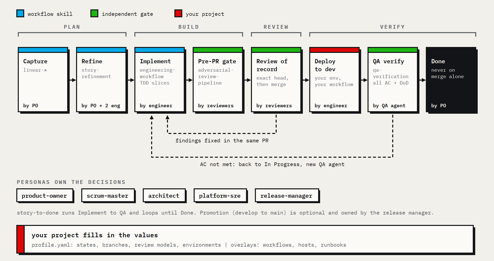

<picture>
  <source media="(prefers-color-scheme: dark)" srcset="marketing/icon/agent-skills-128-dark.png">
  
</picture>

# agent-skills

Base skills for coding agents: an engineering process (story lifecycle, TDD, review of record, deploy verification) packaged as [Agent Skills](https://agentskills.io/specification).
They carry process only.
Each project supplies its own values through a profile and its own operational detail through overlays.

The skills are runtime-neutral; CI checks that opencode discovers every one, and they load the same way in Claude Code.

## Workflow

<picture>
  <source media="(prefers-color-scheme: dark)" srcset="marketing/workflow/workflow-dark.png">
  
</picture>

Every story passes the same gates: a pre-PR adversarial check, an independent review of record on the exact head, then QA against the acceptance criteria on a deployed environment.
Done is never "merged".

## Skills

| Skill | Use it to |
|---|---|
| [`engineering-workflow`](skills/engineering-workflow/SKILL.md) | Implement a story end to end: triage, TDD slices, pre-PR gate, PR, review of record, merge, deploy, verify. |
| [`adversarial-review-pipeline`](skills/adversarial-review-pipeline/SKILL.md) | Pre-PR adversarial gate: preflight, sweep, empirical hunt, one arbitration pass, fix and re-verify. |
| [`qa-verification`](skills/qa-verification/SKILL.md) | Verify a deployed story against its acceptance criteria and decide Done, back to In Progress, or Blocked. |
| [`story-refinement`](skills/story-refinement/SKILL.md) | Run independent refinement and secret pointing with the SM/EM facilitating and the PO plus two engineers voting. |
| [`persona-product-owner`](skills/persona-product-owner/SKILL.md) | Own the backlog and story lifecycle: triage, refinement, estimation, status, closure. |
| [`persona-scrum-master`](skills/persona-scrum-master/SKILL.md) | Run sprint planning, the async standup, the sprint review, the retrospective, and the DoR/DoD gate, and report velocity and burnup as a report-only scrum master or engineering manager. |
| [`persona-release-manager`](skills/persona-release-manager/SKILL.md) | Own release readiness, the promotion PR's review of record, production verification coordination, and the hand-offs, while deploy, rollback, evidence, and status stay with the skills that own them. |
| [`persona-architect`](skills/persona-architect/SKILL.md) | Write, supersede, and trace decision records, and review design work against the records and engineering practice. |
| [`persona-platform-sre`](skills/persona-platform-sre/SKILL.md) | Infrastructure as code, CI/CD, deploys, host operations, and incident diagnosis. |
| [`persona-staff-engineer`](skills/persona-staff-engineer/SKILL.md) | Own a story's design and premises, delegate implementation, and run its review gates. |
| [`persona-staff-devops`](skills/persona-staff-devops/SKILL.md) | Own an infrastructure story's design and blast radius, delegate the work, and run its review gates. |
| [`story-to-done`](skills/story-to-done/SKILL.md) | Implement a story to deployment review with a senior engineer, QA it, and loop fixes until Done. |
| [`linear-user-story`](skills/linear-user-story/SKILL.md) | File a Linear user story from the standard template. |
| [`linear-bug`](skills/linear-bug/SKILL.md) | File a Linear bug with observed, expected, and fix sections. |
| [`linear-spike`](skills/linear-spike/SKILL.md) | File a timeboxed Linear spike. |
| [`linear-investigation`](skills/linear-investigation/SKILL.md) | File an investigation story after an alert or page. |
| [`linear-epic`](skills/linear-epic/SKILL.md) | Create a Linear epic (a project) with goal, value, DoR, DoD, and a T-shirt size. |

## Install

Clone once, then link the skills where your runtime looks for them.

```bash
git clone https://github.com/noahwhite/agent-skills ~/src/agent-skills
```

| Runtime | User-wide | One project |
|---|---|---|
| Claude Code | `~/.claude/skills/` | `.claude/skills/` |
| opencode | `~/.agents/skills/` or `~/.config/opencode/skills/` | `.agents/skills/` or `.opencode/skills/` |

```bash
mkdir -p ~/.claude/skills
ln -s ~/src/agent-skills/skills/* ~/.claude/skills/
```

opencode also reads `~/.claude/skills/`, so the link above serves both runtimes.
Install each skill in one place only, so a runtime does not see it twice.

Each skill is self-contained: the files it references live in its own `references/` directory, so copying a single skill directory also works.

## Profile

A profile is a YAML file with the values that differ between projects: tracker team and state names, branches, review models, environments.
The skills look for it in this order:

1. `$AGENT_SKILLS_PROFILE`
2. `.agent-skills/profile.yaml` in the current repository
3. `~/.config/agent-skills/profile.yaml`

Start from [`profile/example.yaml`](profile/example.yaml); [`profile/schema.json`](profile/schema.json) defines every key.
Besides the tracker, git and environment values, a profile names the agents of each review stage.
The pre-PR adversarial gate has five roles under `review.pre_pr`: `sweeper`, `hunter`, `arbiter`, `simplicity_reviewer` and `fixer`.
`hunter` and `arbiter` must be set for the pre-PR gate; the gate is blocked while either is unset.
`sweeper` is optional, and `simplicity_reviewer` and `fixer` are used only when the gate escalates; see [`skills/adversarial-review-pipeline/SKILL.md`](skills/adversarial-review-pipeline/SKILL.md).
A skill that needs a value the profile does not set stops and asks for it rather than guessing.

## Overlays

An overlay is a Markdown file that adds a project's operational detail to one skill or shared capability: which workflow deploys, which host to check, which runbook applies.
Map it in the profile:

```yaml
overlays:
  engineering-workflow: overlays/engineering-workflow.md
  code-review: overlays/code-review.md
```

The agent reads the overlay after the skill.
An overlay can add detail and tighten rules; it can loosen a rule only where the base skill says that behavior is configurable.
Keep overlays with the project that owns them, not in this repository.

## Runtimes

Skill text names capabilities ("record a todo list", "spawn a subagent", "ask the user") instead of tools.
[`shared/runtimes.md`](shared/runtimes.md) maps each capability to Claude Code and opencode tools.
Review roles run as subagents or as shell-launched CLIs (for example `codex exec`), as each role's `runtime` in the profile says.

## Contributing

- Shared rules are written once in `shared/` and copied into each skill's `references/` by `scripts/vendor_shared.py`; `skills.json` lists which skill gets which file.
  Edit the source in `shared/`, then run `python3 scripts/vendor_shared.py`.
- `uv run pytest` checks spec frontmatter, links that stay inside each skill, runtime-neutral wording, profile keys against the schema, vendored copies, and the leak scan.
- `scripts/leak_scan.py` rejects personal data, internal addresses and credential shapes; the public patterns are generic.
  Names to keep out (consumers, their hosts, vendors, issue keys) are private patterns, one regex per line, from the `LEAK_DENYLIST` repository secret or a file named by `LEAK_DENYLIST_FILE`; matches are reported by pattern number only.
  CI fails when private patterns are missing, except on pull requests from forks, which get no secrets; a maintainer runs `LEAK_DENYLIST_FILE=<file> python3 scripts/leak_scan.py --require-private` before merging one.
- `scripts/smoke-opencode.sh` installs the skills into a scratch project and checks that opencode discovers every one.
- Markdown puts one sentence per line.

## License

[Apache-2.0](LICENSE)
